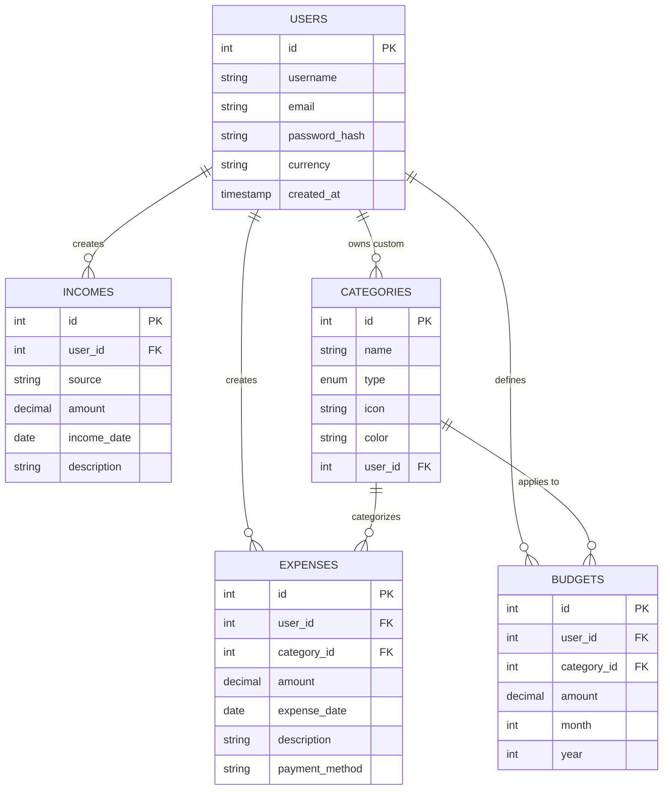

# 💜 Smart Expense Tracker Web Application

[](https://www.python.org/)
[](https://flask.palletsprojects.com/)
[](https://www.mysql.com/)
[](LICENSE)

A modern, responsive, full-stack **Smart Expense Tracker Web Application** engineered with **Python (Flask)**, **MySQL**, and modern **HTML5/CSS3/JavaScript (ES6+)**. Designed with a soft pastel aesthetic (purples, blues, and whites), interactive **Chart.js** analytics, rule-based **Smart Spending Insights**, and robust multi-user authentication.

---

## 🌟 Key Features

### 🔐 1. User Authentication & Multi-Tenancy
- **User Registration & Login**: Secure account creation with email, unique username, and preferred currency.
- **Strong Security**: Password hashing via **Werkzeug** PBKDF2/SHA-256 algorithms.
- **Strict Data Isolation**: Each user can only view, manage, and export their own financial transactions.
- **Session Management**: Secure session cookies with automatic expiration.
- **Preferences**: Update preferred currency (`$`, `₹`, `€`, `£`, `¥`, etc.) and change passwords anytime.

### 📊 2. Dynamic Financial Dashboard
- **Instant KPIs**: Real-time summary cards for **Net Balance**, **Total Income**, **Total Expenses**, and **Monthly Budget**.
- **Interactive Visualizations**:
  - **Expense Trends (Line Chart)**: 6-month historical trajectory of income vs. expenses.
  - **Category Breakdown (Donut Chart)**: Visual split of spending for the current month.
- **Recent Activity Feed**: Combined chronologically sorted feed of recent incomes and expenses with category color tags.
- **Quick Actions**: One-click modal triggers to log expenses and income from anywhere.

### 💸 3. Expense Management
- **Full CRUD Support**: Add, edit, and delete expense entries.
- **Categorization**: Default categories with distinct icons and colors:
  - 🍔 *Food* &bull; 🛍️ *Shopping* &bull; ✈️ *Travel* &bull; 🎓 *Education* &bull; 🎬 *Entertainment* &bull; 🧾 *Bills* &bull; 🩺 *Healthcare* &bull; 📁 *Others*
- **Payment Method Tracking**: Cash, Credit Card, Debit Card, UPI/Online, Bank Transfer.
- **Search & Filters**: Instant filtering by category, month, and keyword search.

### 💰 4. Income Management
- **Income Tracking**: Log income from multiple sources (Salary, Freelance, Investments, Side Business, Gifts, etc.).
- **Edit & Delete**: Seamless modal editing with pre-filled values.
- **Income Summaries**: Display monthly and all-time total earnings.

### 🎯 5. Budget Management & Alert System
- **Monthly Budget Targets**: Configure overall monthly spending limits or category-specific caps.
- **Visual Progress Bars**: Animated meters indicating percentage utilized.
- **Smart Warning Thresholds**:
  - 🟢 **Healthy (< 80%)**: Safe spending progress.
  - 🟡 **Warning (80% - 99%)**: Proactive alert banner notifying that spending is approaching limits.
  - 🔴 **Exceeded (≥ 100%)**: Critical alert displaying exact deficit amounts.

### 🧠 6. Smart Analytics & Saving Suggestions
- **Spending Velocity & Drift**: Calculates month-over-month percentage change.
- **Savings Rate Calculation**: Tracks ratio of income saved `((Income - Expense) / Income * 100)`.
- **Top Spending Driver**: Highlights your highest expense category and its share of your budget.
- **Actionable Financial Advice**:
  - High dining out warnings with saving estimates.
  - Subscription/entertainment audit recommendations.
  - 50/30/20 budget pacing guidance.

### 📑 7. Reports & CSV Export
- **Custom Filtering**: Query transactions by custom start date, end date, category, and record type (All / Expense / Income).
- **Filtered Summary**: Automatically calculates income, expenses, and net savings for the query range.
- **1-Click CSV Export**: Downloads standard `.csv` file formatted for Excel or Google Sheets.

---

## 🎨 UI/UX Design System
- **Pastel Color Palette**: Soft Lavender (`#EDE9FE`), Purple Accent (`#7C3AED`), Sky Blue (`#DBEAFE`), Emerald Green (`#10B981`), Rose Red (`#F43F5E`), and Crisp Slate surfaces.
- **Typography**: Clean, readable Google Font (*Plus Jakarta Sans*).
- **Responsive Layout**: Fluid desktop sidebar with collapsible mobile hamburger drawer.
- **Micro-Interactions**: Smooth card hover elevation, modal backdrop blur, and animated progress transitions.

---

## 🛠️ Technology Stack

| Layer | Technology |
|---|---|
| **Frontend** | HTML5, CSS3, JavaScript (ES6+), Chart.js, Lucide Icons |
| **Backend** | Python 3.10+, Flask 3.x, Jinja2 Templates |
| **Database** | MySQL Server 8.0+, PyMySQL |
| **Security** | Werkzeug Security (PBKDF2 SHA-256), python-dotenv |

---

## 📂 Project Architecture

```
smart expenses tracker/
├── app.py                      # Flask Application Factory & Entry Point
├── config.py                   # Environment & Application Settings
├── database.py                 # MySQL Connection Pool & Initialization
├── schema.sql                  # MySQL DDL Schema & Default Seeds
├── requirements.txt            # Python Dependencies
├── .env.example                # Template for Environment Configuration
├── .gitignore                  # Git Ignore Configuration
├── README.md                   # Project Documentation
│
├── routes/                     # Blueprint Modular Architecture
│   ├── __init__.py             # Auth Guard Decorator (@login_required)
│   ├── auth.py                 # Login, Register, Logout, Profile
│   ├── dashboard.py            # Overview KPIs & Chart Data JSON API
│   ├── expenses.py             # Expense CRUD & Filtering
│   ├── incomes.py              # Income CRUD & Tracking
│   ├── budgets.py              # Budgeting & Alert Engine
│   ├── analytics.py            # Trend Analytics & Smart Insights
│   └── reports.py              # Filtered Reports & CSV Export
│
├── services/                   # Core Business Logic
│   ├── __init__.py
│   └── insights_service.py     # Rule-based Smart Recommendation Engine
│
├── static/                     # Static Frontend Assets
│   ├── css/
│   │   ├── style.css           # Pastel Design System & Responsive Styles
│   │   └── auth.css            # Authentication Screen Styles
│   └── js/
│       ├── main.js             # UI Interactions, Modals, Toasts
│       └── charts.js           # Chart.js Integration & Pastel Palettes
│
└── templates/                  # Jinja2 HTML Templates
    ├── base.html               # Shared Master Layout with Sidebar
    ├── dashboard.html          # Main Dashboard
    ├── expenses.html           # Expense Management Page
    ├── income.html             # Income Tracking Page
    ├── budgets.html            # Budget Management Page
    ├── analytics.html          # Deep Analytics & Smart Insights
    ├── reports.html            # Custom Reports & CSV Downloader
    ├── auth/
    │   ├── login.html          # Sign In Page
    │   ├── register.html       # Sign Up Page
    │   └── profile.html        # Preferences & Security Settings
    └── errors/
        ├── 404.html            # Not Found Page
        └── 500.html            # Server Error Page
```

---

## 🗄️ Database Schema (MySQL)



---

## 🚀 Getting Started & Installation

### Prerequisites
- **Python 3.10+** installed on your system.
- **MySQL Server 8.0+** running locally (or via XAMPP / WampServer / Docker).

### Step 1: Clone the Repository
```bash
git clone https://github.com/your-username/smart-expense-tracker.git
cd smart-expense-tracker
```

### Step 2: Create a Virtual Environment
```bash
# Windows
python -m venv venv
venv\Scripts\activate

# macOS / Linux
python3 -m venv venv
source venv/bin/activate
```

### Step 3: Install Dependencies
```bash
pip install -r requirements.txt
```

### Step 4: Configure Environment Variables
Copy the template `.env.example` to `.env`:
```bash
cp .env.example .env
```
Open `.env` and specify your MySQL credentials:
```ini
FLASK_APP=app.py
FLASK_ENV=development
FLASK_DEBUG=1
SECRET_KEY=generate_a_secure_random_key_here

# MySQL Configuration
MYSQL_HOST=localhost
MYSQL_PORT=3306
MYSQL_USER=root
MYSQL_PASSWORD=your_actual_mysql_password
MYSQL_DB=smart_expense_tracker
```

### Step 5: Initialize MySQL Database
The application **automatically creates the database and initializes all tables and seed categories** upon startup.

Alternatively, you can manually run `schema.sql` via MySQL CLI or MySQL Workbench / phpMyAdmin:
```bash
mysql -u root -p < schema.sql
```

### Step 6: Launch the Application
```bash
python app.py
```
Open your browser and navigate to:
👉 **`http://127.0.0.1:5000`**

---

## 📸 Screenshots

*(Replace with screenshots from your running application for your portfolio)*

| Dashboard View | Smart Analytics |
|:---:|:---:|
|  |  |

| Budget Tracker | Expenses & Filters |
|:---:|:---:|
|  |  |

---

## 🔒 Security Best Practices
- **No hardcoded secrets**: All passwords and keys reside in `.env`, which is strictly ignored by `.gitignore`.
- **SQL Injection Prevention**: Every query utilizes parameterized SQL statements via PyMySQL cursors.
- **Password Protection**: Passwords are never stored in plaintext; Werkzeug PBKDF2 salt hashing is enforced.

---

## 🎓 Academic / Portfolio Highlights
This project was constructed to demonstrate:
1. **Full-stack MVC/Blueprint architecture** in Python Flask.
2. **Relational database design** with MySQL, indexing, and cascade rules.
3. **Responsive UI engineering** with custom CSS variables and zero bulky CSS framework bloat.
4. **Data visualization** utilizing Chart.js canvas APIs.
5. **Heuristic AI-like recommendation algorithms** for automated personal finance coaching.

---

## 📄 License
This project is licensed under the MIT License - feel free to use and customize it for your portfolio!
